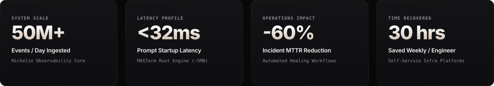
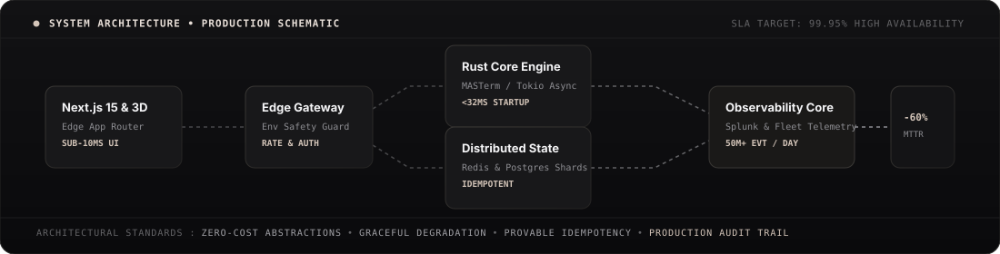
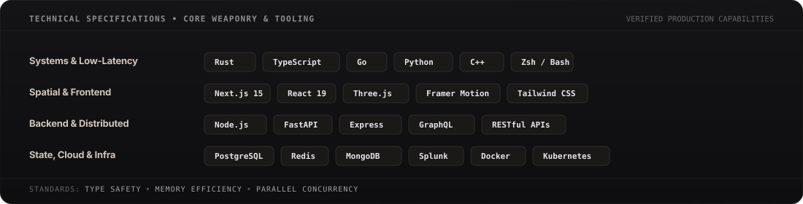

<div align="center">

  <!-- Apple Keynote Titanium Hero Banner -->
  <a href="https://mridulsinghal.com">
    
  </a>

  <br/><br/>

  <!-- Minimalist Navigation Bar -->
  <p align="center">
    <a href="https://mridulsinghal.com"><b>Portfolio</b></a> &nbsp;•&nbsp;
    <a href="https://github.com/singhalmridul/MASTerm"><b>MASTerm (Rust)</b></a> &nbsp;•&nbsp;
    <a href="https://github.com/singhalmridul/masai"><b>M.A.S. Security</b></a> &nbsp;•&nbsp;
    <a href="https://www.linkedin.com/in/mridulsinghal/"><b>LinkedIn</b></a> &nbsp;•&nbsp;
    <a href="mailto:mridulsinghal11@gmail.com"><b>Contact</b></a>
  </p>

  <br/>

  <!-- Keynote Hardware-Grade Metrics Grid -->
  

</div>

<br/>

---

### Overview

I architect, build, and operate production software systems end-to-end—spanning high-throughput distributed infrastructure, low-latency compiled runtimes in Rust, and spatial web applications.

At Michelin, I engineered observability platforms ingesting **50M+ daily events** across multi-region clusters, designing self-healing automation that reduced mean time to recovery (**MTTR**) by **60%** and recovered **30+ engineering hours weekly**. My engineering focus centers on zero-cost abstractions, provable idempotency under high concurrency, and graceful degradation during failure states.

<br/>

---

### Technical Deep Dives &amp; Case Studies

<details>
<summary><b>Case Study: High-Throughput Event Ingestion at Michelin (50M+ Evt/Day)</b></summary>

<br/>

```
[SYSTEM PROFILE] Enterprise Distributed Observability Architecture
[DAILY THROUGHPUT] 50,000,000+ telemetry events processed across global infrastructure
[UPTIME SLA] 99.95% high availability with zero unhandled drop cascades
[MTTR REDUCTION] Slashing incident resolution time from 2 hours to sub-15 minutes (-60%)
```

<div align="center">
  
</div>

#### Key Architectural Decisions
* **Deterministic Idempotency**: Configured cryptographic content hashing on inbound payloads to eliminate duplicate processing caused by upstream network retries.
* **Ring-Buffered Backpressure**: Deployed locally buffered ring memory at edge nodes to gracefully queue metrics during central ingestion spikes without memory ballooning.
* **Self-Healing Runbooks**: Developed automated remediation routines for node failover, certificate lifecycle rotation, and automated log pruning.

</details>

<br/>

<details>
<summary><b>Systems Engineering: MASTerm Sub-50ms Shell Runtime in Rust</b></summary>

<br/>

```
[RUNTIME] MASTerm Core Engine (Compiled Rust)
[COLD START] 31.4ms startup latency (vs. 210ms+ in standard Oh-My-Zsh setups)
[MEMORY FOOTPRINT] 4.8MB static binary with zero runtime garbage collection pauses
```

* **Parallel Asynchronous Gatherers**: Utilized `tokio` multi-threading to collect Git status, Kubernetes contexts, and environment variables concurrently rather than sequentially.
* **Production Safety Guard**: Real-time AST-level inspection of shell inputs to intercept destructive commands (`rm -rf`, `DROP TABLE`, unanchored branch force-pushes) inside production-tagged hosts.
* **Zero-Cost Abstractions**: Engineered modular traits allowing zero-copy parsing of shell hooks across Zsh, Bash, and Fish shells.

👉 **[Inspect MASTerm on GitHub](https://github.com/singhalmridul/MASTerm)**

</details>

<br/>

<details>
<summary><b>Security Engineering: Autonomous Multi-Agent Vulnerability Swarms</b></summary>

<br/>

```
[ARCHITECTURE] M.A.S. AI & AI Bug Bounty Hunter Swarm Engine
[COORDINATION] 10+ autonomous scanning agents operating on an event-driven knowledge graph
[TRIAGE FOCUS] AST-level JavaScript parsing & authenticated logic flaw detection
```

* **Living Attack Graph**: Rather than naive regex searches, specialized agents construct an entity graph mapping endpoints, state parameters, and permissions.
* **Multi-Agent Specialization**: Independent agents dedicate computational bandwidth to recon, auth tampering, SQL injection, and proof-of-concept verification.
* **Automated PoC Generation**: Automatically validates and renders reproducible curl reproduction scripts to accelerate remediation timelines.

👉 **[Inspect M.A.S. AI on GitHub](https://github.com/singhalmridul/masai)** • **[Inspect AI Bug Bounty Hunter](https://github.com/singhalmridul/ai-bug-bounty-hunter)**

</details>

<br/>

<details>
<summary><b>Spatial &amp; 3D Web: Next.js 15 &amp; WebGL Architecture</b></summary>

<br/>

```
[PLATFORM] mridulsinghal.com & Flux Polymorphic Spatial Workspace
[ENGINEERING] Next.js 15 App Router (React 19) + Three.js Shaders + Framer Motion
[BENCHMARK] Constant 60 FPS viewport rendering with sub-1.2s Largest Contentful Paint
```

* **GPU Memory Lifecycle**: Implemented deterministic disposal routines for geometries, textures, and render targets during route transitions to eliminate WebGL context exhaustion.
* **Edge Pre-rendering**: Static composition of layout hierarchies combined with progressive streaming of dynamic 3D scenes.
* **Flux Spatial OS**: Conceptualized an enterprise canvas unifying ideation, execution, and calendar coordination into one spatial plane.

👉 **[Launch 3D Portfolio](https://mridulsinghal.com)** • **[View Codebase](https://github.com/singhalmridul/mridulsinghal.com)**

</details>

<br/>

---

### Selected Engineering Projects

#### 1. MASTerm — Master Your Terminal
*Blazing-fast, intelligent, cross-shell terminal framework built in Rust.*
* Built in Rust with `tokio`, `clap`, and `ratatui` for sub-50ms startup times (~5MB binary).
* Integrated Production Safety Guard protecting production systems from accidental high-impact commands.
* **[Source Code](https://github.com/singhalmridul/MASTerm)** • **[Crate Specs](https://github.com/singhalmridul/MASTerm)**

#### 2. M.A.S. AI — Adaptive Security Swarm
*Defensive-first, AI-powered penetration testing and vulnerability analysis platform.*
* Orchestrates 10+ autonomous agents modeling an adversarial red team against target attack surfaces.
* Replaces static signature matching with dynamic graph-based vulnerability discovery.
* **[Source Code](https://github.com/singhalmridul/masai)**

#### 3. mridulsinghal.com — 3D Spatial Portfolio
*Engineering portfolio designed with spatial glassmorphism and Three.js viewports.*
* Built on Next.js 15 App Router, React 19, and hardware-accelerated shaders.
* Includes interactive system architecture case studies and production postmortems.
* **[Live Site](https://mridulsinghal.com)** • **[Source Code](https://github.com/singhalmridul/mridulsinghal.com)**

#### 4. AI Bug Bounty Hunter
*Autonomous security analyst utilizing context-aware crawling and exploit chaining.*
* Parses frontend bundles via AST analysis to surface hidden APIs and misconfigured authorization endpoints.
* **[Source Code](https://github.com/singhalmridul/ai-bug-bounty-hunter)**

<br/>

---

### Technical Specifications &amp; Core Tooling

<div align="center">
  
</div>

<br/>

---

### Verified Public Metrics

<div align="center">
  
</div>

<br/>

---

### Connect

I welcome conversations regarding distributed systems architecture, compiled low-latency runtimes, and high-scale engineering challenges.

* **Portfolio**: [mridulsinghal.com](https://mridulsinghal.com)
* **LinkedIn**: [linkedin.com/in/mridulsinghal](https://www.linkedin.com/in/mridulsinghal/)
* **Email**: [mridulsinghal11@gmail.com](mailto:mridulsinghal11@gmail.com)
* **X**: [@MridulSinghal16](https://x.com/MridulSinghal16)
* **GitHub**: [github.com/singhalmridul](https://github.com/singhalmridul)

<br/>

<div align="center">
  
</div>
