<!-- ================================================================= -->
<!--                   MRIDUL SINGHAL // SPATIAL OS                    -->
<!--       Full-Stack Engineer & Systems Architect | New Delhi, IN    -->
<!-- ================================================================= -->

<div align="center">

  <!-- 3D Isometric Holographic Core Mainframe -->
  <a href="https://mridulsinghal.com">
    
  </a>

  <br/><br/>

  <!-- High-Frequency Animated Typing Subtitle -->
  <a href="https://mridulsinghal.com">
    
  </a>

  <br/>

  <!-- Telemetry Badges Strip -->
  <p align="center">
    <a href="https://mridulsinghal.com">
      
    </a>
    &nbsp;
    <a href="https://komarev.com/ghpvc/?username=singhalmridul">
      
    </a>
    &nbsp;
    <a href="https://github.com/singhalmridul?tab=repositories">
      
    </a>
    &nbsp;
    <a href="https://www.linkedin.com/in/mridulsinghal/">
      
    </a>
  </p>

</div>

<br/>

<!-- ================================================================= -->
<!--                SECTION 1: SYSTEM NEOFETCH TERMINAL               -->
<!-- ================================================================= -->

<div align="center">
  
</div>

<br/>

<!-- ================================================================= -->
<!--              SECTION 2: LIVE PERFORMANCE TELEMETRY                -->
<!-- ================================================================= -->

<div align="center">
  
</div>

<br/>

---

<!-- ================================================================= -->
<!--           SECTION 3: INTERACTIVE MISSION EXPLORATION HUB          -->
<!-- ================================================================= -->

## 🕹️ Choose Your Exploration Protocol

> **[!] CLICK ANY SYSTEM PROTOCOL BELOW TO EXPAND ARCHITECTURAL EVIDENCE, BENCHMARKS & RUNTIME LOGS:**

<br/>

<details>
<summary><b>🔥 [PROTOCOL 01 : THE 50M+ DISTRIBUTED OBSERVABILITY PIPELINE]</b> — <i>Click to inspect Michelin production scale</i></summary>

<br/>

```
[SYS_TRACE] PIPELINE INITIALIZED // SOURCE: MICHELIN FLEET TELEMETRY
[THROUGHPUT] 50,000,000+ daily events ingested and transformed in real time
[RELIABILITY] 99.95% availability SLA across multi-region infrastructure
[INCIDENT MTTR] Reduced by 60% through automated event correlation & alerting
[OPS AUTOMATION] 30+ engineering hours saved weekly via self-service platforms
```

#### 📐 End-to-End Pipeline Wireframe
<div align="center">
  
</div>

* **Architectural Decisions & Tradeoffs**:
  * **Event Idempotency**: Implemented deterministic hashing on inbound telemetry payloads to guarantee zero duplicate executions even during aggressive network retries.
  * **Graceful Degradation**: Edge collectors queue metrics locally in ring buffers when upstream forwarders throttle, preventing catastrophic data drops during traffic surges.
  * **Automated Runbooks**: Packaged self-healing scripts for certificate rotation, automated log pruning, and dynamic cluster rebalancing.

</details>

<br/>

<details>
<summary><b>🦀 [PROTOCOL 02 : SUB-50MS RUST RUNTIME &amp; TOOLING]</b> — <i>Click to inspect MASTerm &amp; Systems Programming</i></summary>

<br/>

```
[SYSTEM] MASTerm Core Engine v0.3.1 (Rust Edition)
[BENCHMARK] Cold startup: 31.4ms | Steady prompt: 14.2ms | Memory: 4.8MB
[SAFETY] AST-level production command interception: ACTIVE
```

```
           SHELL STARTUP LATENCY BENCHMARK (LOWER IS BETTER)
┌───────────────────────────────────────────────────────────────┐
│ Oh-My-Zsh (Standard plugins)  ████████████████████ 220ms      │
│ Starship (Default config)     ████████ 85ms                   │
│ MASTerm (Rust Parallel Core)  ███ 31ms ⚡                     │
└───────────────────────────────────────────────────────────────┘
```

* **Core Technical Innovations**:
  * **Parallel Asynchronous Plugin Engine**: Leveraged `tokio` multi-threading to execute 11+ independent environment gatherers concurrently, eliminating serial bottlenecks.
  * **Zero-Cost Abstractions**: Minimized runtime footprint down to ~5MB native binary compared to 50MB+ managed language alternatives.
  * **Production Safety Guard**: Real-time regex & AST shell inspection that blocks destructive commands (`rm -rf`, `DROP TABLE`, uncapped force pushes) inside production environments.

👉 **[Inspect MASTerm on GitHub](https://github.com/singhalmridul/MASTerm)** • `cargo install masterm`

</details>

<br/>

<details>
<summary><b>🛡️ [PROTOCOL 03 : AUTONOMOUS MULTI-AGENT AI SECURITY SWARM]</b> — <i>Click to inspect M.A.S. AI</i></summary>

<br/>

```
[AI_SWARM] DISPATCHING DEFENSIVE PENTEST SQUADRON (10 SPECIALIZED AGENTS)
  ├── 01. ReconAgent       ──> Attack surface topology & DNS mapping
  ├── 02. ASTCrawler       ──> Reverse-engineers frontend JS bundles for hidden endpoints
  ├── 03. AuthFuzzer       ──> JWT tampering, OAuth edge cases, broken object level auth
  ├── 04. InjectionProber  ──> Blind SQLi, NoSQL injection, server-side template injection
  ├── 05. GraphReasoner    ──> Chains low-priority anomalies into high-impact exploit vectors
  └── 06. PoCGenerator     ──> Produces deterministic, reproducible curl & script proofs
```

* **How It Works**:
  * Rather than relying on simple pattern-matching, **M.A.S. AI** builds a living knowledge graph of target applications.
  * Agents communicate via an event bus to simulate a coordinated human red team, validating security postures before adversaries can exploit them.

👉 **[Explore M.A.S. AI](https://github.com/singhalmridul/masai)** &bull; **[Explore AI Bug Bounty Hunter](https://github.com/singhalmridul/ai-bug-bounty-hunter)**

</details>

<br/>

<details>
<summary><b>✨ [PROTOCOL 04 : 3D SPATIAL COMPUTING &amp; NEXT.JS 15]</b> — <i>Click to inspect mridulsinghal.com &amp; Flux</i></summary>

<br/>

```
[FRONTEND] Next.js 15 App Router (React 19) + Three.js + Framer Motion
[VIEWPORT] 3D interactive hero canvas with customized fragment shaders
[PERFORMANCE] Perfect 60 FPS scroll cadence & sub-1.2s Largest Contentful Paint
[DESIGN SYSTEM] Spatial Glassmorphic UI with dynamic perspective lighting
```

* **Engineering Highlights**:
  * **Server-Driven Geometry**: Static pre-rendering of complex layout hierarchies paired with client-side WebGL canvas streaming.
  * **Memory Optimization**: Explicit GPU geometry and texture disposal during route transitions to eliminate WebGL memory leaks.
  * **Polymorphic Spatial Workspaces**: Architected `Flux`, an enterprise OS concept unifying Ideation, Execution, and Scheduling into one seamless canvas.

👉 **[Launch 3D Portfolio](https://mridulsinghal.com)** &bull; **[View Portfolio Codebase](https://github.com/singhalmridul/mridulsinghal.com)**

</details>

<br/>

<details>
<summary><b>🕹️ [PROTOCOL 05 : INTERACTIVE TERMINAL SIMULATOR &amp; SECRETS]</b> — <i>Click to run hidden commands</i></summary>

<br/>

```bash
$ mridul --query-philosophies
> [RULE 1] "Premature optimization is evil; but unmeasured slowness is criminal."
> [RULE 2] "If it isn't monitored, it isn't running in production."
> [RULE 3] "Idempotency saves weekends."

$ mridul --fun-fact
> "I debug with console.log, write sub-50ms prompts in Rust, and run on single-origin pour-overs ☕"

$ mridul --status
> [STATUS: ONLINE] Always open to challenging distributed systems architecture,
> high-throughput infra, and autonomous AI engineering roles worldwide.
```

</details>

<br/>

---

<!-- ================================================================= -->
<!--               SECTION 4: FLAGSHIP CYBERDECK PROJECTS             -->
<!-- ================================================================= -->

## 🚀 Flagship Cyberdeck Projects

<br/>

<table>
  <tr>
    <td width="50%" valign="top">
      <div>
        <h3>🦀 <a href="https://github.com/singhalmridul/MASTerm">MASTerm — Master Your Terminal</a></h3>
        <p><b>Blazing-fast, intelligent, cross-shell terminal framework built in Rust (Zsh, Bash, Fish).</b></p>
        <p>Replaces sluggish shell startup times with sub-50ms asynchronous prompt rendering, parallel multi-threaded plugin execution, and built-in production safety guards.</p>
        <br/>
        <p>
          <a href="https://github.com/singhalmridul/MASTerm"></a>
          &nbsp;
          <a href="https://github.com/singhalmridul/MASTerm"></a>
        </p>
        <p>
          <a href="https://github.com/singhalmridul/MASTerm"><b>[ 📦 Inspect Rust Crate ]</b></a> &nbsp;&bull;&nbsp;
          <a href="https://github.com/singhalmridul/MASTerm"><b>[ ⚡ Read Benchmarks ]</b></a>
        </p>
      </div>
    </td>
    <td width="50%" valign="top">
      <div>
        <h3>🛡️ <a href="https://github.com/singhalmridul/masai">M.A.S. AI — Adaptive Security Swarm</a></h3>
        <p><b>Defensive-First AI-Powered Penetration Testing &amp; Vulnerability Platform.</b></p>
        <p>Enterprise-grade security scanner orchestrating 10+ specialized agents for context-aware crawling, intelligent exploitation graphing, and automated risk scoring.</p>
        <br/>
        <p>
          <a href="https://github.com/singhalmridul/masai"></a>
          &nbsp;
          <a href="https://github.com/singhalmridul/masai"></a>
        </p>
        <p>
          <a href="https://github.com/singhalmridul/masai"><b>[ 🛡️ Deploy Security Swarm ]</b></a> &nbsp;&bull;&nbsp;
          <a href="https://github.com/singhalmridul/masai"><b>[ 🔍 View Topology ]</b></a>
        </p>
      </div>
    </td>
  </tr>
  <tr>
    <td width="50%" valign="top">
      <div>
        <h3>✨ <a href="https://mridulsinghal.com">mridulsinghal.com — 3D Spatial Portfolio</a></h3>
        <p><b>Engineering-first personal portfolio built with Next.js 15, Three.js, and Framer Motion.</b></p>
        <p>Featuring a 3D interactive hero section, spatial glassmorphism design system, and deep architectural case studies of enterprise platforms.</p>
        <br/>
        <p>
          <a href="https://mridulsinghal.com"></a>
          &nbsp;
          <a href="https://mridulsinghal.com"></a>
        </p>
        <p>
          <a href="https://mridulsinghal.com"><b>[ 🌐 Launch Interactive 3D ]</b></a> &nbsp;&bull;&nbsp;
          <a href="https://github.com/singhalmridul/mridulsinghal.com"><b>[ 📂 GitHub Codebase ]</b></a>
        </p>
      </div>
    </td>
    <td width="50%" valign="top">
      <div>
        <h3>🔍 <a href="https://github.com/singhalmridul/ai-bug-bounty-hunter">AI Bug Bounty Hunter</a></h3>
        <p><b>The Autonomous Security Analyst that never sleeps. Context-aware crawling &amp; exploitation.</b></p>
        <p>Graph-based vulnerability reasoning agent capable of chaining low-severity findings into actionable high-impact security alerts.</p>
        <br/>
        <p>
          <a href="https://github.com/singhalmridul/ai-bug-bounty-hunter"></a>
          &nbsp;
          <a href="https://github.com/singhalmridul/ai-bug-bounty-hunter"></a>
        </p>
        <p>
          <a href="https://github.com/singhalmridul/ai-bug-bounty-hunter"><b>[ ⚡ Explore Bounty Engine ]</b></a> &nbsp;&bull;&nbsp;
          <a href="https://github.com/singhalmridul/ai-bug-bounty-hunter"><b>[ 🔬 View AST Parser ]</b></a>
        </p>
      </div>
    </td>
  </tr>
</table>

<br/>

---

<!-- ================================================================= -->
<!--               SECTION 5: THE NEURAL TECH MATRIX                  -->
<!-- ================================================================= -->

## 🧬 Neural Tech Stack &amp; Weapons of Choice

<div align="center">

| Architecture Tier | Weaponry &amp; Core Tooling |
| :--- | :--- |
| **🦀 Systems &amp; Low-Latency** | <a href="https://skillicons.dev"></a> |
| **🌐 Spatial &amp; 3D Frontend** | <a href="https://skillicons.dev"></a> |
| **⚡ Backend &amp; Event Streams** | <a href="https://skillicons.dev"></a> |
| **💾 Distributed Storage &amp; Cache** | <a href="https://skillicons.dev"></a> |
| **☁️ Cloud, DevOps &amp; Observability** | <a href="https://skillicons.dev"></a> |

</div>

<br/>

---

<!-- ================================================================= -->
<!--            SECTION 6: CONTRIBUTION SNAKE & ANALYTICS              -->
<!-- ================================================================= -->

## 🎮 Contribution Matrix &amp; Stack Telemetry

<div align="center">
  <!-- Glowing Animated Contribution Snake -->
  
</div>

<br/>

<div align="center">
  <!-- Rock-solid Self-Contained Stats Card (No Rate Limits, No External Outages) -->
  
</div>

<br/>

---

<!-- ================================================================= -->
<!--              SECTION 7: DEV FLOW STATE AUDIO RADAR                -->
<!-- ================================================================= -->

<div align="center">
  
</div>

<br/>

---

<!-- ================================================================= -->
<!--             SECTION 8: SECURE TRANSMISSION FREQUENCIES           -->
<!-- ================================================================= -->

## 📡 Open Transmission Frequencies

<div align="center">
  <p><b>Got a complex distributed systems challenge, an AI agent experiment, or a high-throughput problem?</b></p>
  <br/>

  <a href="https://www.linkedin.com/in/mridulsinghal/">
    
  </a>
  &nbsp;
  <a href="https://mridulsinghal.com">
    
  </a>
  &nbsp;
  <a href="https://x.com/MridulSinghal16">
    
  </a>
  &nbsp;
  <a href="mailto:mridulsinghal11@gmail.com">
    
  </a>
  &nbsp;
  <a href="https://github.com/singhalmridul">
    
  </a>
</div>

<br/>

<!-- Animated Cyberpunk Footer Waves -->
<div align="center">
  
</div>
