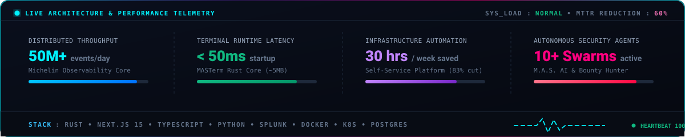
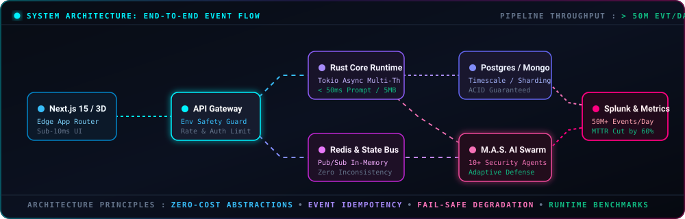
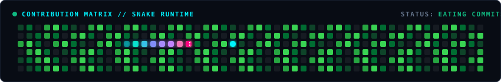

<!-- ======================================================= -->
<!--          MRIDUL SINGHAL - GITHUB PROFILE README         -->
<!--  Full-Stack Engineer & Systems Architect | New Delhi, IN -->
<!-- ======================================================= -->

<div align="center">
  <!-- Motion Graphics Hero Banner -->
  <a href="https://github.com/singhalmridul">
    
  </a>

  <br/><br/>

  <!-- High-Performance Animated Typing Subtitle -->
  <a href="https://github.com/singhalmridul">
    
  </a>

  <br/>

  <!-- Metric Badges Strip -->
  <p align="center">
    <a href="https://komarev.com/ghpvc/?username=singhalmridul">
      
    </a>
    &nbsp;
    <a href="https://github.com/singhalmridul?tab=followers">
      
    </a>
    &nbsp;
    <a href="https://github.com/singhalmridul?tab=repositories">
      
    </a>
    &nbsp;
    <a href="https://github.com/singhalmridul">
      
    </a>
  </p>

  <br/>

  <!-- Live Telemetry & Architecture HUD -->
  

</div>

<br/>

---

### ⚡ Operational Philosophy & About Me

<table>
<tr>
<td width="60%" valign="top">

```typescript
interface SystemsEngineer {
  name: "Mridul Singhal";
  location: "New Delhi, India 🇮🇳";
  role: "Full-Stack Engineer & Systems Architect";
  scaleExperience: {
    eventThroughput: "50M+ events / day";
    incidentMTTR: "Reduced by 60%";
    opsAutomated: "30+ engineering hrs / week saved";
    uptimeTarget: "99.95% high availability";
  };
  specializations: [
    "Distributed Systems & Enterprise Observability",
    "Sub-50ms CLI Runtimes (Rust)",
    "Autonomous AI Multi-Agent Security Swarms",
    "Interactive 3D Web & Next.js 15 Architecture"
  ];
  architecturalPrinciples: [
    "Zero-cost abstractions over bloated runtimes",
    "Design for failure & graceful degradation",
    "Idempotency in all state transitions"
  ];
}
```

- 🔭 **Enterprise Scale**: Architected distributed observability platforms at Michelin handling **50M+ events/day**, automating critical operations and slashing MTTR by **60%**.
- 🦀 **Low-Latency Runtimes**: Created **MASTerm**, a modular terminal intelligence engine in Rust executing parallel plugins with **sub-50ms prompt latency**.
- 🛡️ **Autonomous Security**: Engineered **M.A.S. AI** & **AI Bug Bounty Hunter**, defensive-first autonomous security swarms with 10+ scanning agents.
- 🌐 **Modern Frontend & 3D**: Crafting spatial web experiences with Next.js 15, Three.js, and Framer Motion.

</td>
<td width="40%" valign="top">

<div align="center">
  <br/>
  
  <br/><br/>
  
  <br/><br/>
  
  <br/><br/>
  
</div>

</td>
</tr>
</table>

<br/>

---

### 🌐 End-to-End System Architecture

<div align="center">
  <p><i>Live Data Wireframe: From Client Edge through Rust Runtimes to AI Defense Swarms &amp; Observability</i></p>
  
</div>

<br/>

---

### 🚀 Flagship Engineering Projects

<table>
  <tr>
    <td width="50%" valign="top">
      <div align="left">
        <h3>🦀 <a href="https://github.com/singhalmridul/MASTerm">MASTerm — Master Your Terminal</a></h3>
        <p><b>Blazing-fast, intelligent, cross-shell terminal framework built in Rust (Zsh, Bash, Fish).</b></p>
        <p>Replaces sluggish shell environments with a sub-50ms async prompt engine, parallel multi-threaded plugin execution, and built-in production safety guards.</p>
        <p>
          
          
          
        </p>
        <details>
          <summary><b>📐 View Architectural Highlights</b></summary>
          <ul>
            <li><b>Rust vs Managed:</b> Zero-cost abstractions yielding 5MB native binaries vs 50MB+ runtime footprints.</li>
            <li><b>Hybrid Plugin Core:</b> 11+ native gatherers running async in parallel with sandboxed WASM extensions.</li>
            <li><b>Prod Safety Guard:</b> AST-level environment detection preventing destructive operations in production shells.</li>
          </ul>
        </details>
      </div>
    </td>
    <td width="50%" valign="top">
      <div align="left">
        <h3>🛡️ <a href="https://github.com/singhalmridul/masai">M.A.S. AI — Adaptive Security Swarm</a></h3>
        <p><b>Defensive-First AI-Powered Penetration Testing &amp; Vulnerability Platform.</b></p>
        <p>Enterprise-grade security scanner orchestrating 10+ specialized agents for context-aware crawling, intelligent exploitation graphing, and automated risk scoring.</p>
        <p>
          
          
          
        </p>
        <details>
          <summary><b>📐 View Architectural Highlights</b></summary>
          <ul>
            <li><b>Multi-Agent Swarm:</b> Specialized agents for recon, authentication fuzzing, SQL injection, and logic bypass.</li>
            <li><b>Knowledge Graph:</b> Real-time mapping of attack surfaces and dependency relationships.</li>
            <li><b>Zero Blindspots:</b> Autonomous crawling engine simulating human pentester intuition.</li>
          </ul>
        </details>
      </div>
    </td>
  </tr>
  <tr>
    <td width="50%" valign="top">
      <div align="left">
        <h3>✨ <a href="https://github.com/singhalmridul/mridulsinghal.com">mridulsinghal.com — 3D Spatial Portfolio</a></h3>
        <p><b>Engineering-first personal portfolio built with Next.js 15, Three.js, and Framer Motion.</b></p>
        <p>Featuring a 3D interactive hero section, glassmorphic design system, and in-depth architectural case studies of production platforms.</p>
        <p>
          
          
          
        </p>
        <details>
          <summary><b>📐 View Architectural Highlights</b></summary>
          <ul>
            <li><b>Server Components:</b> Edge CDN caching with zero hydration mismatch.</li>
            <li><b>Performance First:</b> 3D canvas lazy-loaded to preserve 60fps scrolling and Core Web Vitals.</li>
          </ul>
        </details>
      </div>
    </td>
    <td width="50%" valign="top">
      <div align="left">
        <h3>🔍 <a href="https://github.com/singhalmridul/ai-bug-bounty-hunter">AI Bug Bounty Hunter</a></h3>
        <p><b>The Autonomous Security Analyst that never sleeps. Context-aware crawling &amp; exploitation.</b></p>
        <p>Graph-based vulnerability reasoning agent capable of chaining low-severity findings into actionable high-impact security alerts.</p>
        <p>
          
          
          
        </p>
        <details>
          <summary><b>📐 View Architectural Highlights</b></summary>
          <ul>
            <li><b>AST Analysis:</b> Deep parsing of JavaScript source bundles to discover hidden API endpoints.</li>
            <li><b>Automated PoC Generation:</b> Produces verified, reproducible reproduction scripts for bug triage.</li>
          </ul>
        </details>
      </div>
    </td>
  </tr>
</table>

<br/>

---

### 🛠️ Technology Stack & Core Competencies

<div align="center">

| Domain | Technologies &amp; Tools |
| :--- | :--- |
| **Systems &amp; Core** | <a href="https://skillicons.dev"></a> |
| **Frontend &amp; 3D Web** | <a href="https://skillicons.dev"></a> |
| **Backend &amp; Distributed** | <a href="https://skillicons.dev"></a> |
| **Databases &amp; Caching** | <a href="https://skillicons.dev"></a> |
| **Cloud, DevOps &amp; Observability** | <a href="https://skillicons.dev"></a> |

</div>

<br/>

---

### 🎮 Contribution Grid & Live Activity

<div align="center">
  <!-- Dynamic Contribution Snake Game -->
  
</div>

<br/>

<div align="center">
  <table>
    <tr>
      <td width="50%" align="center">
        <!-- GitHub Detailed Stats Card -->
        <a href="https://github.com/singhalmridul">
          
        </a>
      </td>
      <td width="50%" align="center">
        <!-- Top Languages Card -->
        <a href="https://github.com/singhalmridul">
          
        </a>
      </td>
    </tr>
  </table>
</div>

<br/>

---

### 🎵 Dev Flow State & Audio Telemetry

<div align="center">
  
</div>

<br/>

---

### 🤝 Connect & Collaborate

<div align="center">
  <p><b>Always interested in distributed systems challenges, autonomous AI agents, and high-performance engineering.</b></p>

  <a href="https://www.linkedin.com/in/mridulsinghal/">
    
  </a>
  &nbsp;
  <a href="https://mridulsinghal.com">
    
  </a>
  &nbsp;
  <a href="https://x.com/MridulSinghal16">
    
  </a>
  &nbsp;
  <a href="mailto:mridulsinghal11@gmail.com">
    
  </a>
  &nbsp;
  <a href="https://github.com/singhalmridul">
    
  </a>
</div>

<br/>

<!-- Animated Cyberpunk Footer -->
<div align="center">
  
</div>
